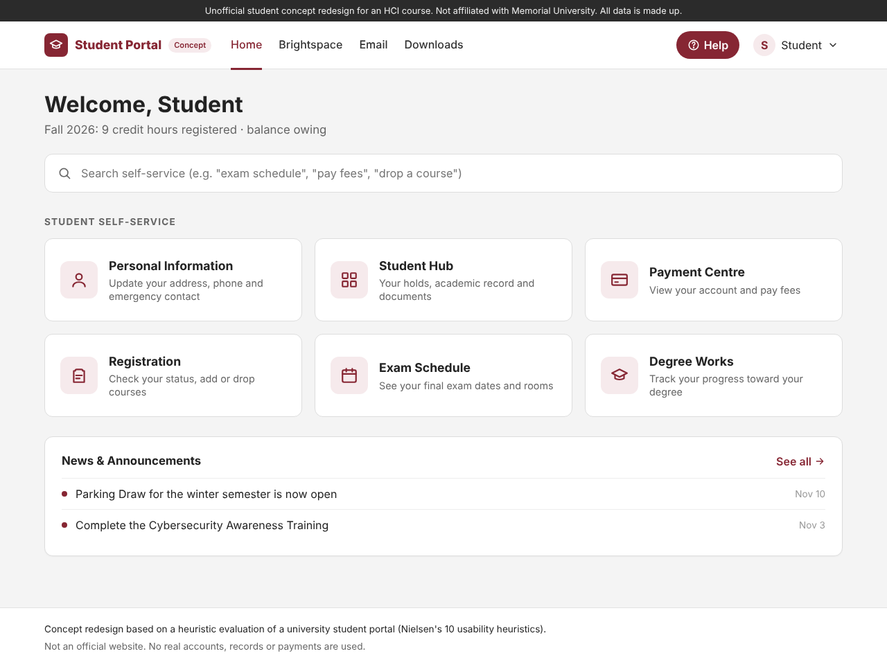
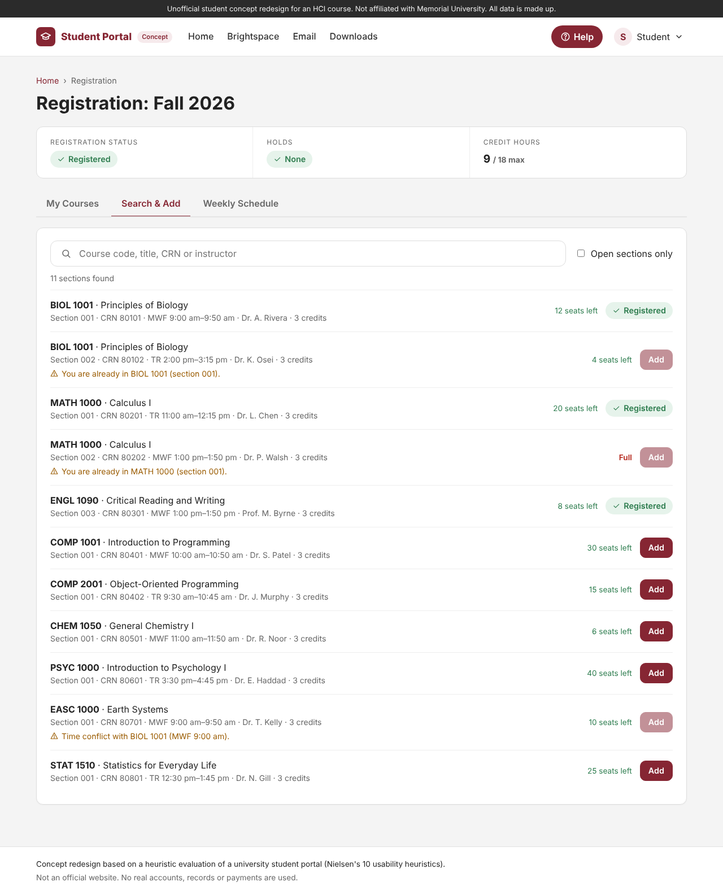

# Student Portal: Concept Redesign

**Live demo:**
https://mun-portal-redesign.vercel.app


A working front-end redesign of a university student self-service portal, built from a usability evaluation.

> **Unofficial student project.** This is a concept redesign made for an HCI course. It is **not affiliated with Memorial University**, it doesn't connect to any real university system, and all names, courses, grades and payments are made up.



## Background

In an HCI course, my partner and I ran a heuristic evaluation (Nielsen's 10 usability heuristics) on our university's student portal, then designed and prototyped fixes. This project turns that prototype into a working web app.

| Problem found in the evaluation | Heuristic | What this redesign does |
|---|---|---|
| Large promotional boxes crowd out the tools students need | Aesthetic and Minimalist Design | Tools come first; announcements are a short list with "See all" |
| Help is a tiny unlabelled "?" icon, plus a separate "Support" button | Help and Documentation | A labelled **Help** button on every page, a searchable Help Centre, and step-by-step answers that link straight to the task |
| Navigation is split into two areas with two styles, and Brightspace appears twice | Consistency and Standards | One navigation bar in one style, the same on every page, with breadcrumbs |
| Pages are slow to open with no feedback | Visibility of System Status | Loading screens, button states ("Adding…"), and confirmation toasts |

## Features

- **Search** across all tools and help answers from the home page
- **Registration**: search the catalog, add and drop courses, and see a weekly schedule. Adding a course is blocked if:
  - it overlaps another course
  - you're already in that course
  - the section is full
  - you'd go over 18 credit hours
  
  Drops ask for confirmation, and both adds and drops can be undone.
- **Payment Centre**: balance and charges that update with your courses, plus a review-then-confirm payment flow. It's a demo, so no money or bank details are involved.
- **Personal Information**: an editable profile with inline validation (phone, postal code, email)
- **Student Hub**: holds, academic record with averages, and downloadable demo documents
- **Exam Schedule**: exams for your registered courses, a same-day warning, and **Add to calendar** (.ics)
- **Degree Works**: requirement progress bars that show completed and in-progress credits
- **Help Centre**: topics, search, numbered steps, and "Was this helpful?"
- Responsive phone layout, keyboard-accessible menus and dialogs, and a skip link
- Your changes are saved in your browser (localStorage). Use **Student ▾ → Reset demo data** to start over.



## Tech

React 18, React Router 6, and Vite. Plain CSS, with no UI library and no backend: the "server" is simulated with short delays so the loading states are visible.

## Run it locally

```bash
npm install
npm run dev
```

Then open http://localhost:5173.

## Deploy on Vercel

1. Push this folder to a GitHub repository.
2. In Vercel, choose **Add New → Project** and import the repository.
3. Vercel detects Vite automatically (build command `npm run build`, output folder `dist`). Click **Deploy**.

`vercel.json` makes page links like `/registration` work when you refresh or share them.

## Project structure

```
src/
  App.jsx               routes
  lib/data.js           all demo data (courses, exams, fees, help topics)
  lib/store.jsx         app state, registration rules, toasts
  components/           layout, icons, loader, modal, breadcrumbs
  pages/                one file per page
```

## Credits

Heuristic evaluation, paper prototypes and Figma prototype by Fatema Al-asbahi and Sadia Afrin.
